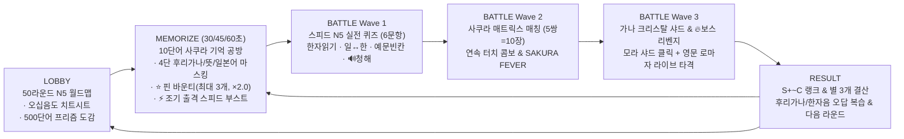

# PRISM NIHONGO N5 — Game Architecture & Module Contract

> **Project**: 일본어 JLPT N5 필수 500단어 사쿠라 오로라 글래스모피즘 미니게임 (*Sakura Aurora & Kyoto Crystal Edition*)  
> **Local Workspace Path**: `C:\Users\USER\.gemini\antigravity\scratch\jlpt-n5-voca-800` (배포 저장소: `jlpt-n5-voca-500`)  
> **Curriculum Scale**: **순수 JLPT N5 핵심 필수 500단어 (`50 ROUNDS × 10 WORDS = 500 고유 어휘` · `Lv.1 R1~20 / Lv.2 R21~38 / Lv.3 R39~50`)**  
> **Runtime Principle**: 빌드 도구·번들러·외부 CDN 없이 로컬 `file://` 더블클릭 실행 및 GitHub Pages(`https://`) 양쪽에서 100% 즉시 동작하는 `window.N5App` 전역 네임스페이스 아키텍처. 모든 총계/라운드 상한은 하드코딩 없이 실제 로드된 데이터 배열 길이(기본값 `500`단어 / `50`라운드)를 동적으로 참조합니다.

---

## 1. 파일 소유권 및 스크립트 로드 파이프라인 (`index.html`)

모든 JS 모듈은 최상단에서 `(typeof window !== 'undefined' ? window : globalThis).N5App`을 안전하게 초기화하여 브라우저(`file://`, `https://`)와 Node/VM/Headless Chrome 자동화 검증(`tests/verify-all.mjs`) 양쪽에서 에러 없이 로드되어야 합니다.

```html
<!-- 1. JLPT N5 500 Data Layer (@n5-curator) -->
<script src="src/data/words-part1.js"></script>
<script src="src/data/words-part2.js"></script>
<script src="src/data/words-index.js"></script>

<!-- 2. Japanese Cognitive Learning, Romaji, Gojuon & Unified Audio/Storage (@n5-pedagogue) -->
<script src="src/js/learning-system.js"></script>

<!-- 3. Core Game State Machine, 3-Wave N5 Generator & Live Romaji Bridge (@n5-architect) -->
<script src="src/js/game-engine.js"></script>

<!-- 4. Sakura Glassmorphism Frontend, Furigana & Event Binding (@n5-ui-artist) -->
<script src="src/js/app-ui.js"></script>
```

| 모듈 / 파일 | 독점 소유 에이전트 | 전역 네임스페이스 노출 객체 |
|---|---|---|
| `src/data/words-part1.js` (R1~25, ID 1~250), `words-part2.js` (R26~50, ID 251~500), `words-index.js`, `scripts/validate-words.mjs` | `@n5-curator` | `N5App.WORDS_500` (별칭 `N5App.words`, `N5App.WORDS_800`), `N5App.ROUNDS_50` (별칭 `N5App.ROUNDS_80`), `N5App.WordBank` |
| `src/js/learning-system.js`, `docs/LEARNING_DESIGN.md` | `@n5-pedagogue` | `N5App.LearningSystem` (`RomajiHelper`, `GOJUON_DATA`, `sfx`, `tts` 단일 통합), `N5App.RomajiHelper` |
| `src/js/game-engine.js`, `docs/GAME_ARCHITECTURE.md` | `@n5-architect` | `N5App.GameEngine` (상태 머신·타이머·N5 3-Wave·가나 샤드/로마자 브릿지·점수/피버/쉴드) |
| `index.html`, `src/css/glassmorphism.css`, `src/css/animations.css`, `src/js/app-ui.js` | `@n5-ui-artist` | `N5App.UI` (사쿠라 글래스모피즘·`<ruby>` 후리가나·4단 성에 마스킹·오십음도·500단어 도감) |
| `tests/verify-all.mjs`, `scripts/publish-github.ps1`, `README.md`, `.gitignore` | `@n5-qa-release` | 전수 무결성/Headless Chrome E2E 검증 & `jlpt-n5-voca-500` GitHub 공개 저장소/Pages 배포 |

---

## 2. 핵심 JLPT N5 게임 루프 아키텍처



1. **Phase 1 — 사쿠라 프리즘 기억 공방 (`MEMORIZE`, 기본 45초, 30/45/60초 설정 + `+15초` 연장 1회)**:
   - 10개 단어를 그리드 뷰 / 3D 플립 포커스 뷰로 학습하며 **일본어 특화 4단 능동 인출 마스킹** 지원:
     - `all` (전체 보기) | `furigana` (`<ruby><rt>` 후리가나만 성에 블러 처리 — 오쿠리가나는 유지!) | `meaning` (한국어 뜻 가리기) | `japanese` (일본어 표기 전체 가리기; `expression` 별칭 호환)
   - **⭐ 핀 바운티 (Pin Bounty)**: 라운드 내 헷갈리는 단어 최대 3개 지정 → 배틀 정답 시 **점수 ×2.0 바운티 폭발**!
   - **⚡ 조기 출격 부스트 (Early Start Bonus)**: 남은 시간에 비례해 **즉시 보너스(`남은초 × 15점`) + 라운드 점수 배율(`x1.00 ~ x1.30`) + 초기 SAKURA FEVER 게이지(`최대 40%`)** 획득!

2. **Phase 2 — JLPT N5 실전 직결 3-Wave 입체 인출 배틀 (`BATTLE`)**:
   - **Wave 1 (재인 — 스피드 N5 실전 퀴즈 6문항)**:
     1. **`kanji-to-kana` (N5 언어지식 1교시 한자 읽기)**: `Boolean(word.kanji)`인 단어에 출제(순수 가나 단어 `kanji === ""`는 자동으로 `jp-to-ko`/`ko-to-jp`로 안전 분기!). 문제 본문은 후리가나 없는 순수 `kanji`/`expression`만 노출하고, `WordBank.getKanaDistractors`로 생성한 **장음(`おう/えい/ー`)·촉음(`っ`)·탁음/청음·요음 함정 보기 3개 + 정답 `kana`** 중 선택! 판정(`FEEDBACK`) 시 `revealRubyHtml`과 `tip` 공개.
     2. **`jp-to-ko` (일본어 → 한국어 뜻)**: `rubyHtml` 포함 표기를 보고 한국어 뜻 선택.
     3. **`ko-to-jp` (한국어 뜻 → 일본어 표기)**: 한국어 뜻을 보고 알맞은 일본어 어휘 선택.
     4. **`cloze` (일본어 문맥 빈칸)**: `WordBank.getBlankExample(word, '［　　］')` 일본어 예문 빈칸 + `exampleKo`를 보고 정답 선택.
     5. **`listening` (`subType: 'audio-to-ko'`, N5 청해)**: `ja-JP` TTS 자동 발음 + 이모지·품사 단서로 한국어 뜻 맞히기.
   - **Wave 2 (연합 — 사쿠라 글래스 매트릭스 매칭 1보드 = 5쌍 10타일)**:
     - 남은 5개 핵심 단어의 일본어 표기(`side: 'jp'`) ↔ 한국어 뜻(`side: 'ko'`, `reading-only` 스타일 시 한자↔히라가나 읽기) 스피드 매칭. 연속 성공으로 콤보와 SAKURA FEVER 게이지 급속 충전!
   - **Wave 3 (산출 & 리벤지 — 가나 크리스탈 샤드 `kana-spelling` 3문항 + 🔥보스/리벤지 피날레 1~2문항)**:
     - **모라(박자) 단위 가나 샤드(`splitMorae`)**: `せんせい` → `['せ','ん','せ','い']`, `がっこう` → `['が','っ','こ','う']`, `きょうしつ` → `['きょ','う','し','つ']`, `コーヒー` → `['コ','ー','ヒ','ー']` (요음 `ゃ/ゅ/ょ/ャ/ュ/ョ` 등은 앞 글자와 결합한 1모라 샤드, 촉음 `っ/ッ`·발음 `ん/ン`·장음 `ー`는 독립 1모라 샤드) + 장음/촉음/탁음 함정 샤드 2~3개 셔플!
     - **듀얼 입력 (샤드 클릭 + 영문 키보드 로마자 라이브 브릿지)**: 일본어 IME가 없는 한국 플레이어가 일반 영문 키보드로 `sensei`, `gakkou`, `chotto`, `shinbun`, `minna`, `koohii`(`ko-hi-`) 등을 타이핑하면 실시간 `romajiBuffer`가 갱신되며 매칭되는 미사용 가나 샤드가 자동으로 착착 선택됨!
     - **🔥 피날레 보스 & 즉시 복수전**: ⭐핀 단어, 이번 라운드 Wave 1~2 오답 단어(최대 2개 즉시 보스 큐 추가), `LearningSystem.getRevengeWords()` 이전 라운드 약점 단어가 피날레 보스로 등장!

3. **손맛 & 기억 정착 시스템**:
   - **콤보 배율 (`1.0x ~ 2.0x`) & SAKURA FEVER (12초간 점수 `×2.0` + 타이머 감속 `0.7x`)**
   - **글래스 쉴드 (기본 1개, 10콤보마다 +1 충전, 최대 2개)**: 오답 1회 시 콤보 및 서바이벌 하트 보호.
   - **하이퍼코렉션 각인 피드백**: 오답 시 **2.4초간 정답 `rubyHtml`·`kana`·`koPron`·한자음 비교 `tip` 노출 + `ja-JP` 정답 발음 자동 재생** (`180ms` 키보드 연타 스킵 디바운스 락 적용).
   - **3대 플레이 모드**: `campaign` (50라운드 N5 월드맵: Lv.1 입문 기초 R1~20 / Lv.2 핵심 활용 R21~38 / Lv.3 실전 완성 R39~50), `revenge` (약점·⭐별표 10단어 복수 도장, 약점 0개 시 `NO_WEAK_WORDS` 안전 방어), `survival` (하트 3개 무한 서바이벌 블리츠).
   - **5종 배틀 스타일**: `'prism-mix'` (기본 3-Wave), `'quiz-only'`, `'reading-only'` (한자 읽기 & 가나 집중 특훈), `'match-only'`, `'kana-only'` (별칭 `'spelling-only'` 호환).

---

## 3. 모듈별 상세 API 계약

### 3.1 Data Layer (`window.N5App.WORDS_500`, `ROUNDS_50`, `WordBank`) — `@n5-curator`

```js
// Word 객체 스키마 (총 500개 고유 어휘, id: 1..500, round: 1..50)
{
  id: 1,
  round: 1,
  level: 1,                  // 1(R1~20 입문기초 200단어) | 2(R21~38 핵심활용 180단어) | 3(R39~50 실전완성 120단어)
  theme: "설레는 첫인사와 교실 사람",
  expression: "先生",        // 대표 표기 (500/500 중복 0건)
  kanji: "先生",             // 한자 포함 시 표기, 순수 히라가나/가타카나 단어는 ""
  kana: "せんせい",          // 전체 히라가나(외래어는 가타카나) 읽기
  rubyHtml: "<ruby>先<rt>せん</rt></ruby><ruby>生<rt>せい</rt></ruby>", // 한자만 <ruby> 래핑, 오쿠리가나는 외부 배치
  romaji: "sensei",          // 공백/특수문자 없는 소문자 영문 (/^[a-z]+$/)
  koPron: "센세-",           // 입문자용 자연스러운 한글 발음 가이드
  pos: "명사",               // "명사"|"1류동사"|"2류동사"|"3류동사"|"い형용사"|"な형용사"|"부사"|"표현"
  meaning: "선생님",         // 명확한 고유 한국어 뜻 (500/500 중복 0건)
  emoji: "👩‍🏫",
  tip: "한국 한자음 '선생'과 구조가 같아요! 끝의 い는 장음이라 '센세-'로 길게 발음합니다.",
  example: "田中先生はとても優しいです。",
  exampleReading: "たなかせんせいはとてもやさしいです。",
  exampleKo: "다나카 선생님은 매우 다정합니다."
}

// Round 메타 스키마 (총 50개)
{
  round: 1,
  level: 1,
  levelLabel: "Lv.1 N5 입문 기초",
  title: "설레는 첫인사와 교실 사람",
  emoji: "👩‍🏫",
  wordIds: [1, 2, 3, 4, 5, 6, 7, 8, 9, 10]
}
```

- **전역 프로퍼티 & 하위 호환 별칭**:
  - 주 배열: `N5App.WORDS_500` (`Word[500]`), `N5App.ROUNDS_50` (`RoundMeta[50]`)
  - 동시 호환 별칭: `N5App.words = N5App.WORDS_500`, `N5App.WORDS_800 = N5App.WORDS_500`, `N5App.ROUNDS_80 = N5App.ROUNDS_50`
  - `WordBank.POS_LIST`: `["명사", "1류동사", "2류동사", "3류동사", "い형용사", "な형용사", "부사", "표현"]`
  - `getAllWords()`, `getAllRounds()`, `getWordById(id)`, `getWordByText(text)`, `getRoundMeta(round)`, `getWordsByRound(round)`, `getWordsByLevel(level)`
  - `getBlankExample(wordOrId, mask = "［　　］")` (동사/형용사 활용 어간 포함 500/500 마스킹 보장)
  - `getDistractors(targetWordOrId, count = 3, opts = { samePos: true, sameLevel: true, onlyKanji: false })`
  - `getKanaDistractors(targetWordOrId, count = 3)` (장음·촉음·탁음·요음 실전 함정 가나 3개 생성, 정답 및 상호 중복 0건 500/500 보장)
  - `searchWords(query, { level, round, pos, hasKanji, ids } = {})`

---

### 3.2 Japanese Cognitive Learning, Romaji, Gojuon & Audio (`window.N5App.LearningSystem`) — `@n5-pedagogue`

> **오디오 일원화 원칙**: 효과음(`sfx`)과 발음(`tts`)은 음소거·속도 설정 단일화를 위해 **`LearningSystem.sfx` 및 `LearningSystem.tts`로 100% 일원화**합니다. `speechSynthesis` 또는 `AudioContext` 미지원/차단/Headless 환경에서도 절대 예외를 던지거나 게임 진행을 블로킹하지 않습니다.

#### A. 초기화 & 라이트너 숙련도 (`STORAGE_KEY = 'prism_jlpt_n5_500_v1'` 또는 `'prism_jlpt_n5_800_v1'` 호환)
- `init()`: `localStorage` 로드(`try/catch` 인메모리 폴백 필수) 및 일일 스트릭 갱신.
- `recordAttempt(wordId, isCorrect, meta = {})`:
  - `meta`: `{ round, mode, questionType, responseMs, isPinned, isRevenge, usedHint }`
  - 반환: `{ wordId, prevBox, newBox, status: 'unseen'|'learning'|'mastered', inWrongNote: boolean, unlockedBadges?: Badge[] }`
- `getWordProgress(wordId)` → `{ wordId, box: 0|1|2|3, status: 'unseen'|'learning'|'mastered', correctCount, wrongCount, pinned: boolean, inWrongNote: boolean, lastSeen }`
- `getMasteryStats()` → `{ total: 500, unseen: number, learning: number, mastered: number, pinnedCount: number, wrongNoteCount: number, clearedRoundsCount: number, totalRounds: 50, totalScore: number, bestCombo: number, streakDays: number, survivalBestScore: number }` (`total`/`totalRounds`는 로드된 배열 길이 동적 반영)
- `getWordsForCodex({ status, query, level, round, pos } = {})` → 도감 필터링 단어 목록

#### B. ⭐ 핀 · 오답 리벤지 · 3단계 일본어 스마트 힌트
- `togglePin(wordId)` → `boolean`, `isPinned(wordId)` → `boolean`, `getPinnedWordIds()` → `number[]`, `getPinnedWords()` → `Word[]`
- `getRevengeWords(currentRound, count = 2)` → `Word[]` (이전 라운드 오답/Box 1 약점 단어 우선 추출, 현재 라운드 단어 제외)
- `getWrongWordIds()` → `number[]`, `getWrongWords(limit)` → `Word[]`, `clearWrongWord(wordId)`
- `getHint(wordOrId, stage = 1)`:
  - `stage 1`: `{ stage: 1, firstKana: "せ", moraCount: 4, kanaSkeleton: "せ ◯ ◯ ◯", koInitials: "ㅅㅅㄴ", pos: "명사", text: "..." }`
  - `stage 2`: `{ stage: 2, clozeExample: "田中［　　］は...", exampleKo: "...", tip: "...", emoji: "👩‍🏫", text: "..." }`
  - `stage 3`: `{ stage: 3, koPron: "센세-", romaji: "sensei", kana: "せんせい", tip: "...", text: "..." }`

#### C. 로마자 스마트 브릿지 (`LearningSystem.RomajiHelper` / `N5App.RomajiHelper`) & 오십음도 (`GOJUON_DATA`)
- `RomajiHelper`:
  - `splitMorae(kana)` → `string[]` (예: `"きょうしつ"` → `["きょ", "う", "し", "つ"]`, `"がっこう"` → `["が", "っ", "こ", "う"]`)
  - `toHiragana(romaji)`, `toKatakana(romaji)`, `toRomaji(kana)`, `kataToHira(str)`, `hiraToKata(str)`
  - `getAcceptedRomaji(kanaUnit, nextUnit)` → `string[]` (헵번식·훈령식·관용 표기 배열)
  - `consumeRomajiBuffer(buffer, remainingUnits, opts)` → `{ matchedCount, matchedUnits, remainingBuffer, isValidPrefix }`
  - `matchesQuery(wordObj, query)` → `boolean`
- `GOJUON_DATA` & `getGojuonData()`:
  - `{ seion, dakuon, handakuon, yoon, specialRules }` (각 셀 `{ hira, kata, romaji, koPron, row, col }` 또는 빈칸 `null`)

#### D. 라운드 기록 · 배지 · 설정 · 통합 오디오 (`sfx` / `tts`)
- `recordRoundClear(resultSummary)` → `{ isNewBest: boolean, prevBestScore: number, roundRecord, unlockedBadges: Badge[] }`
- `getRoundRecord(round)` / `getAllRoundRecords()` / `getBadges()` / `resetProgress()`
- `getSettings()` / `updateSettings(partial)`:
  - `{ theme: 'midnight-sakura' | 'crystal-sakura-day', memorizeSec: 45, muted: false, ttsEnabled: true, ttsRate: 1.0 | 0.78, ttsLang: 'ja-JP' }`
- `LearningSystem.sfx`:
  - `play(type, param)` 및 개별 메서드(`flip()`, `click()`, `shardTap()`, `correct()`, `combo(n)`, `pinBonus()`, `fever()`, `wrong()`, `shieldBreak()`, `hint()`, `tick()`, `roundClear()`)
  - `setMuted(bool)`, `isMuted()`, `toggleMute()`
- `LearningSystem.tts`:
  - `speak(text, opts)`, `speakWord(wordOrId, opts)` (동형이의 오독 방지를 위해 `kana || expression` 우선 발음 권장), `speakExample(wordOrId)`, `speakKana(kanaChar)`, `stop()`
  - `setRate(1.0 | 0.78)`, `getRate()`, `toggleSpeed()`, `setEnabled(bool)`, `isEnabled()`
- **사운드 호출 분담 (이중 재생 방지)**:
  - **`GameEngine` 전담**: 배틀 판정음(`correct`, `combo`, `pinBonus`, `fever`, `wrong`, `shieldBreak`, `hint`, `shardTap`, `tick`[5초 이하], `roundClear`), `listening` 문제 시작 자동 발음, 오답 발생 시 하이퍼코렉션 정답 단어 자동 발음(`tts.speakWord`).
  - **`UI` 전담**: 카드 플립(`flip`), 버튼/탭 클릭(`click`), 암기 공방·오십음도·도감·배틀 `🔊` 버튼 수동 클릭 시 발음 재생.

---

### 3.3 Core Game Engine (`window.N5App.GameEngine`) — `@n5-architect`

#### A. 상태 머신 (`phase` & `subState`)
- `phase`: `'LOBBY'` | `'MEMORIZE'` | `'BATTLE'` | `'RESULT'`
- `subState`: `'READY'` | `'STUDYING'` | `'PLAYING'` | `'FEEDBACK'` | `'PAUSED'` | `'ENDED'`

#### B. 초기화 · 이벤트 버스 · 스냅샷 (`getState()`)
- `GameEngine.init(options = {})` / `on(eventName, fn)` → `unsubscribe` / `off(eventName, fn)` / `getState()`
- `GameEngine.getTotalRounds()` → 로드된 총 라운드 수 동적 반환 (기본 `50`)
- `GameEngine.getTotalWords()` → 로드된 총 단어 수 동적 반환 (기본 `500`)
- `getState()` 주요 구조:
  ```js
  {
    phase: "LOBBY" | "MEMORIZE" | "BATTLE" | "RESULT",
    subState: "READY" | "STUDYING" | "PLAYING" | "FEEDBACK" | "PAUSED" | "ENDED",
    mode: "campaign" | "revenge" | "survival",
    battleStyle: "prism-mix" | "quiz-only" | "reading-only" | "match-only" | "kana-only",
    round: 1,
    totalRounds: 50,
    roundMeta: { round: 1, level: 1, title: "...", emoji: "👩‍🏫" },
    memorize: {
      words: [...],            // 현재 라운드 10단어 (pinned, box, status, studied 포함)
      totalSec: 45,
      remainingSec: 45,
      remainingMs: 45000,
      extensionsLeft: 1,
      studiedIds: [],
      roundPinnedIds: [],      // 최대 3개
      earlyStartPreview: { remainingSec, bonusPoints, scoreMultiplier, initialFeverGauge, label }
    },
    battle: {
      wave: 1,
      waveTitle: "WAVE 1 · 스피드 N5 실전 퀴즈",
      questionIndex: 0,
      totalQuestions: 11,
      currentQuestion: { ... },
      remainingSec: 10,
      remainingMs: 10000,
      totalSec: 10,
      score: 0,
      combo: 0,
      maxCombo: 0,
      comboMultiplier: 1.0,
      earlyScoreMultiplier: 1.0,
      earlyBonusPoints: 0,
      feverGauge: 0,           // 0..100
      feverActive: false,
      feverRemainingMs: 0,
      shields: 1,              // 최대 2 (10콤보마다 +1)
      hearts: 3,               // survival 전용 차감
      maxHearts: 3,
      hintsRemaining: 2,
      correctCount: 0,
      wrongCount: 0,
      lastFeedback: null
    },
    result: null
  }
  ```

#### C. 모드 시작 & 암기 페이즈 제어 API
- `getRoundsOverview()` (`zone: 'sakura' | 'aoi' | 'kyoto'`, `isRecommended`, `cleared`, `bestScore`, `bestRank`, `stars`)
- `getRecommendedNextRound()` / `canStartRevenge()`
- `startCampaignRound(round = 1, opts = {})` (별칭 `startRound(round, opts)`)
  - `round`: `1 .. getTotalRounds()` (기본 `1..50`)
  - `opts`: `{ memorizeSec?: 30|45|60, battleStyle?: 'prism-mix'|'quiz-only'|'reading-only'|'match-only'|'kana-only'|'spelling-only', skipMemorize?: false, autoSubmitKana?: true }`
- `startRevengeMode(opts = {})` (약점 0개 & `!opts.allowFallback` 시 `{ ok: false, reason: 'NO_WEAK_WORDS' }` 반환 및 `'notice'` 발행)
- `startSurvivalMode(opts = { level: 'all', skipMemorize: true })`
- `retryRound(opts)` / `startNextRound(opts)`
- `extendMemorizeTime(extraSec = 15)` / `markWordStudied(wordId)` / `togglePinInRound(wordId)` / `getEarlyStartPreview()`
- `startBattleFromMemorize()` (별칭 `finishMemorize()`, `startBattleEarly()`)

#### D. 배틀 페이즈 문제 스키마 (`currentQuestion`) & 플레이어 입력 API

1. **Wave 1 — `type: "multiple-choice"` | `"listening"`**
   - `subType`: `'kanji-to-kana'` | `'jp-to-ko'` | `'ko-to-jp'` | `'cloze'` | `'audio-to-ko'`
   - 주요 필드:
     - `prompt` (플레인 텍스트 질문), `promptHtml` (`kanji-to-kana`일 때는 후리가나 없는 순수 한자, `jp-to-ko`일 때는 `rubyHtml` 포함!), `subPrompt`
     - `revealRubyHtml`: `word.rubyHtml || word.expression` (피드백에서 후리가나 전체 공개용)
     - `word`, `emoji`, `pos`, `kana`, `romaji`, `koPron`, `isPinned`, `isRevenge`, `isBoss`
     - `options`: `[{ id: 'opt_0', index: 0, wordId, label, labelHtml, kana, subLabel, isCorrect, eliminated: false }, ...]` (4개 고유 보기 보장)
   - **제출**: `GameEngine.submitAnswer(indexOrOptionIdOrValue)` (`0~3`, `'opt_0'`, 텍스트 모두 허용)

2. **Wave 2 — `type: "pair-match"` (`subType: "matrix-5x2"` | `"kanji-kana-5x2"`)**
   - `words: Word[5]`, `totalPairs: 5`, `matchedPairIds: number[]`, `selectedTileId: string|null`, `hintPairWordId: number|null`
   - `tiles`: `[{ tileId: 'pm_jp_1'|'pm_ko_1', wordId: 1, side: 'jp'|'ko', label: '...', labelHtml: '...', pos: '...', emoji: '...', isPinned: false, matched: false, selected: false }, ...]` (10개 셔플)
   - **조작**: `GameEngine.selectMatchTile(tileId)` / `GameEngine.submitPairMatch(tileIdA, tileIdB)`

3. **Wave 3 — `type: "kana-spelling"` (`subType: "kana-shard"`)**
   - 주요 필드:
     - `prompt`: 한국어 뜻 (`word.meaning`)
     - `kanjiHint`: 한자 표기가 있는 단어는 후리가나 없는 순수 한자(`word.kanji`), 순수 가나 단어는 `""`
     - `subPrompt`: 예문 빈칸 (`blankExample`), `exampleKo`
     - `targetKana`: `word.kana` (예: `"きょうしつ"`), `targetRomaji`: `word.romaji` (예: `"kyoushitsu"`)
     - `targetUnits`: `string[]` (모라 배열, 예: `["きょ", "う", "し", "つ"]`), `targetLength`: `targetUnits.length` (슬롯 개수)
     - `enteredShardIds`: `string[]`, `enteredUnits`: `string[]`, `enteredText`: `string` (완성된 가나 문자열)
     - `romajiBuffer`: `string` (현재 키보드로 타이핑 중인 미완성 영문 로마자 버퍼, 예: `"ky"`), `romajiPreviewKana`: `string` (예상 변환 가이드)
     - `shards`: `[{ shardId: 'sh_0', char: 'きょ', mora: 'きょ', romajiHint: 'kyo', used: false, isDistractor: false }, ...]` (정답 모라 샤드 + 함정 가나 샤드 2~3개 셔플)
   - **조작 & 제출 (Kana & Spelling 양방향 메서드 별칭 완벽 지원)**:
     - `GameEngine.tapKanaShard(shardId)` (별칭 `tapSpellingShard(shardId)`) → 샤드 선택 (`enteredUnits.length === targetLength` 도달 시 자동 제출)
     - `GameEngine.typeKanaKey(key)` (별칭 `typeSpellingKey(key)`) → 영문 알파벳 `'a'~'z'`, `'-'`, `'\''`, 가나 직접 입력, `'Backspace'`(로마자 버퍼가 있으면 버퍼 1글자 먼저 삭제, 버퍼가 비어 있으면 마지막 샤드 취소!), `'Escape'`/`'Clear'`, `'Enter'`(버퍼 끝에 남은 단일 `'n'` 자동 `'ん'/'ン'` 플러시 후 제출!) 완벽 처리!
     - `GameEngine.backspaceKana()` (별칭 `backspaceSpelling()`) → 버퍼 초기화 및 마지막 샤드 취소
     - `GameEngine.clearKana()` (별칭 `clearSpelling()`) → 버퍼 + 선택 샤드 전체 초기화
     - `GameEngine.submitAnswer(typedKanaOrRomaji)` → 가나 문자열 또는 영문 로마자 문자열(`"sensei"`) 직접 제출도 모두 정답 판정 지원!

4. **공통 컨트롤 API**
   - `GameEngine.useHint()` → `multiple-choice`/`listening`: 오답 2개 소거(50:50) + 스마트 힌트 / `kana-spelling`: 오입력 접미사 정리 후 다음 정답 모라 샤드 1개 자동 배치(마지막 1칸 남았을 때는 자동제출 전 힌트 제공) + 스마트 힌트 / `pair-match`: 미매칭 1쌍 `hintPairWordId` 하이라이트.
   - `GameEngine.nextQuestion(opts = { force: true, fromKeyboard: false })` (별칭 `skipFeedback(opts)`) → `fromKeyboard: true`일 때 피드백 진입 후 `180ms` 이내 연타 바운스 자동 차단!
   - `GameEngine.pauseBattle()`, `GameEngine.resumeBattle()`, `GameEngine.abortToLobby()`
   - `GameEngine.splitMorae(kana)` → 모라 분할 유틸리티 공개 노출

#### E. 이벤트 페이로드 규격 (최상위 필드 + `state`/`summary` 중첩 동시 제공)
- `'stateChange'`: `{ ...snapshot, prevPhase, state: snapshot }`
- `'memorizeTick'`: `{ remainingMs, remainingSec, totalSec, progressRatio, earlyBonusPreview }`
- `'memorizeExtended'`, `'pinUpdated'`, `'wordStudied'`
- `'waveStart'`, `'questionStart'`, `'battleTick'`
- `'kanaUpdate'` & `'spellingUpdate'` (동시 발행): `{ questionId, enteredShardIds, enteredUnits, enteredText, romajiBuffer, romajiPreviewKana, shards, targetLength, targetKana }`
- `'pairMatchUpdate'`: `{ action: 'selected'|'deselected'|'switched'|'matched'|'mismatch', tileId?, tileIds?, pairWordId?, matchedCount, totalPairs, selectedTileId, allCleared?, tiles }`
- `'hintUsed'`, `'feverStart'`, `'feverEnd'`, `'shieldBroken'`, `'notice'`
- `'answerResult'`: `{ ok, isCorrect, timedOut, question, submittedAnswer, correctAnswer, revealRubyHtml, correctIndex, selectedIndex, wordId, word, pointsEarned, scoreBreakdown, totalScore, combo, maxCombo, feverGauge, feverActive, isPinned, isRevenge, isBoss, shieldUsed, hearts, maxHearts, imprintDurationMs, learningUpdate }`
- `'roundComplete'`: `{ ...summary, summary, state }`

---

## 4. UI & QA 표준 DOM 셀렉터 계약 (`@n5-ui-artist` & `@n5-qa-release`)

`tests/verify-all.mjs` 및 Headless Chrome CDP E2E가 일관되게 탐색·검증하는 필수 셀렉터 규격입니다:

- **주요 화면 컨테이너 (`[data-screen]`)**:
  - `data-screen="lobby"` (50라운드 N5 월드맵, 모드/배틀스타일 선택, 대시보드)
  - `data-screen="study"` (`MEMORIZE` 10단어 사쿠라 기억 공방)
  - `data-screen="battle"` (`BATTLE` 3-Wave 배틀 화면)
  - `data-screen="result"` (`RESULT` 랭크/후리가나 오답 복습 결산 화면)
  - `data-screen="codex"` (500단어 N5 프리즘 도감 뷰/모달)
  - 오십음도 모달: `#gojuon-modal` 또는 `[data-modal="gojuon"]` (열기: `data-action="open-gojuon"`, 닫기: `data-action="close-gojuon"`)
- **테마 속성**:
  - `document.documentElement.dataset.theme`: `"midnight-sakura"` (다크) | `"crystal-sakura-day"` (라이트)
- **핵심 액션 속성 (`[data-action]`)**:
  - **상단/로비**: `data-action="start-round"` (`data-round="1..50"`), `data-action="start-revenge"`, `data-action="start-survival"`, `data-action="open-codex"`, `data-action="open-gojuon"`, `data-action="toggle-theme"`, `data-action="toggle-mute"`, `data-action="toggle-tts-speed"`
  - **암기 공방 (`study`)**: `data-action="start-battle-early"`, `data-action="extend-time"`, `data-action="toggle-mask"` (`data-mask="all"` | `"furigana"` | `"meaning"` | `"japanese"`), `data-action="flip-card"`, `data-action="toggle-pin"`, `data-action="speak-word"`
  - **배틀 (`battle`)**:
    - 4지선다/청해: `data-action="answer-option"` (`data-index="0..3"`)
    - 매트릭스 매칭: `data-action="match-tile"` (`data-tile-id="..."`)
    - 가나 샤드 & 로마자: `data-action="tap-shard"` (`data-shard-id="..."`), `data-action="kana-backspace"` (또는 `spelling-backspace`), `data-action="kana-clear"` (또는 `spelling-clear`), 라이브 로마자 인디케이터 `#romaji-buffer-display` (또는 `[data-role="romaji-buffer"]`)
    - 공통: `data-action="use-hint"`, `data-action="skip-feedback"`, `data-action="abort-lobby"`
  - **결과 (`result`)**: `data-action="next-round"`, `data-action="retry-round"`, `data-action="back-to-lobby"`
