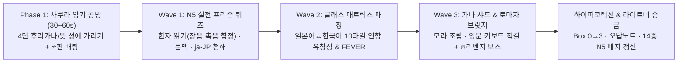

# 🧠 PRISM NIHONGO N5 — 일본어 인지학습 & 한자·청해·신디사이저 설계서 (`LEARNING_DESIGN.md`)

> **"눈으로만 훑는 후리가나 착각(Furigana Fluency Illusion)을 깨고, 45초 4채널 부호화 → 실전 3-Wave 입체 인출 → 간격 반복으로 JLPT N5 필수 500단어를 장기 기억에 각인한다."**

본 문서는 **PRISM NIHONGO N5 (사쿠라 오로라 글래스 에디션 — JLPT N5 핵심 필수 500단어 · 50라운드)** 미니게임에 적용된 일본어 제2언어 습득(SLA)·기억과학 원리와 `window.N5App.LearningSystem` (`src/js/learning-system.js`)의 핵심 아키텍처를 정의합니다.

---

## 1. 한국인 JLPT N5 학습자를 위한 5대 기억과학 원칙

한국인 학습자는 한자문화권이라는 강력한 어휘 이점을 지니는 동시에, **"한자 옆에 적힌 후리가나를 읽고 단어를 다 외웠다고 착각하는 유창성 착각"** 과 **장음(`えい/おう/ー`)·촉음(`っ`)·탁음(`゛`)·발음(`ん`) 박자 혼동**, 그리고 **일본어 키보드(IME) 부재로 인한 산출(Production) 장벽**을 겪습니다. 본 시스템은 순수 JLPT N5 핵심 500단어(Lv.1 입문 R1~20 · Lv.2 핵심 R21~38 · Lv.3 실전 R39~50)를 5가지 기억과학 원리로 정복합니다.

| 인지과학 원리 | 학술적 배경 | PRISM NIHONGO N5 구현 메커니즘 |
| :--- | :--- | :--- |
| **4채널 다중 부호화 (Quadruple Coding)** | Paivio 이중 부호화 + Baddeley 음운 루프 + 한자 형태소 대조 | 암기 카드에 **시각 표기(`expression`/`rubyHtml` + `emoji`) + 음운 박자(`kana`/`koPron`) + 청각 원어민 발음(`ja-JP` TTS `1.0x`/`0.78x`) + 한자음 대조 정교화(`tip` & `example`)** 결합 |
| **메타인지 타겟팅 (Metacognitive Pinning)** | 자기조절학습(Self-Regulated Learning) 및 선택적 주의 집중 | 암기 공방에서 장음·촉음·훈독이 헷갈리는 단어에 **⭐핀(별표, 라운드당 최대 3개 바운티)** 마킹 → 배틀 정답 시 **×2.0 바운티 폭발** |
| **점진적 처리 수준 심화 (Levels of Processing)** | Craik & Lockhart 처리 수준 이론 + Bjork 바람직한 어려움 | **Wave 1 실전 재인(`kanji-to-kana`·`jp-to-ko`·`ko-to-jp`·`cloze`·`listening`) → Wave 2 연합 유창성(5×2 글래스 매칭) → Wave 3 가나 모라 산출(`kana-spelling` & 로마자 라이브 브릿지)** |
| **생성 효과 (Generation Effect)** | 정답 수동 노출 대신 단서 기반 능동 인출 시 기억 흔적 2~3배 강화 | 막힐 때 **① 첫 가나 + 모라 박자 뼈대(`せ ◯ ◯ ◯`) + 뜻 초성 → ② 예문 빈칸(`［　　］`) + 한자음 비교 `tip` → ③ 한글 발음(`koPron`) + 로마자 + `0.78x` 느린 청해** 순 단계별 단서 제공 |
| **하이퍼코렉션 & 라이트너 간격 반복** | Butterfield & Metcalfe 과잉교정 효과 + Ebbinghaus 망각곡선 방어 | 오답 즉시 **2.4초 하이퍼코렉션 각인(`rubyHtml` + 장음/촉음 `tip` + `ja-JP` 발음 자동 재생)** 후 `Box 1` + 오답노트 편입, 이후 **🔥리벤지 보스 카드**로 재출제 |

---

## 2. 일본어 특화 4대 인지 브릿지 메커니즘

### 2.1 `<ruby><rt>` 4단 성에 가리기 (Active Recall Frost Masking)
- `[전체 보기(all)]` · `[후리가나 가리기(furigana)]` · `[뜻 가리기(meaning)]` · `[일본어 가리기(japanese)]` 4단 인출 필터를 통해 학습자가 후리가나 의존성을 스스로 끊고 한자 독음과 의미를 능동 인출하게 유도합니다.

### 2.2 로마자 스마트 브릿지 (`LearningSystem.RomajiHelper`)
한국 PC·노트북·모바일에서 별도의 일본어 IME 전환 없이 영문 자판만으로 Wave 3 가나 샤드 타격과 500단어 도감 검색이 이루어지도록 **헵번식(Hepburn) + 훈령식(Kunrei-shiki) + 관용 키보드 입력(Wapuro IME) 전면 호환 엔진**을 내장합니다.

- **다중 표기 완벽 흡수**:
  - 치경·구개 마찰/파찰음: `し(shi/si)`, `ち(chi/ti)`, `つ(tsu/tu)`, `ふ(fu/hu)`, `じ(ji/zi)`, `ぢ(di/ji/zi)`, `づ(du/zu/dzu)`
  - 요음(拗音) 전 조합: `しゃ(sha/sya)`, `しゅ(shu/syu)`, `しょ(sho/syo)`, `ちゃ(cha/tya/cya)`, `ちゅ(chu/tyu/cyu)`, `ちょ(cho/tyo/cyo)`, `じゃ(ja/jya/zya)` 및 외래어 가타카나(`ティ ti/thi`, `ファ fa`, `フォ fo` 등)
  - 촉음(促音 `っ/ッ`): 뒷자음 중복(`gakkou`, `chotto`, `kippu`, `zasshi`)은 물론 철도/여권식 `tch`(`matcha`/`maccha`, `kotchi`/`kocchi`)와 단독 입력(`xtu/ltu`) 동시 지원
  - 발음(撥音 `ん/ン`): `nn`/`n'` 확정, 자음 앞 단일 `n`(`sensei`, `shinbun`), 양순음(`b/p/m`) 앞 `m`(`shimbun`, `sampo`), 어말 단일 `n`(`hon`, `san`, `shinbun`), `n`행 앞 2연타/3연타(`onna`/`onnna`) 모두 무결점 매칭
  - 가타카나 장음(`ー`): 하이픈(`ko-hi-`, `depa-to`)과 앞 모음 반복(`koohii`, `depaato`, `suupaa`) 양쪽 모두 매칭
- **실시간 버퍼 상태기 (`consumeRomajiBuffer(buffer, remainingUnits, opts)`)**:
  - Wave 3 샤드가 글자 단위(`['き', 'ょ', 'う']`)로 쪼개지든 모라 단위(`['きょ', 'う']`)로 쪼개지든 자동 감지하여 `{ matchedCount, matchedUnits, remainingBuffer, isValidPrefix, previewKana }`를 즉시 반환합니다.

### 2.3 오십음도(五十音図) 인터랙티브 치트시트 데이터 (`GOJUON_DATA`)
- 입문자가 언제든 상단 `あ/ア 오십음도` 모달을 열어 음가를 확인하고 귀로 익힐 수 있도록 구조화된 내장 테이블을 제공합니다:
  - `seion`: 청음 기본 46자 (10행 × 5열 정규 그리드, `や·わ`행 빈칸 `null` 정렬 포함)
  - `dakuon` & `handakuon`: 탁음 20자(`が~ぼ`) 및 반탁음 5자(`ぱ~ぽ`)
  - `yoon`: 필수 요음 33조합(`きゃ~りょ`, `ぎゃ~ぴょ`)
  - `specialRules`: 한국인이 가장 많이 틀리는 N5 3대 박자 규칙(`っ/ッ` 촉음 1박 휴지, `ー/おう/えい` 장음 2박 유지, `ん/ン` 비음 변이) 요약 및 예시 단어 수록

---

## 3. 라이트너 숙련도 모델 (Leitner Mastery Box 0 ~ 3)

로드된 모든 JLPT N5 어휘(기본 500개, `id: 1 ~ 500`, 배열 길이 동적 참조)는 개별 라이트너 박스와 오답·핀 이력을 추적합니다.

| Box 단계 | 도감 상태 (`status`) | 학습 의미 | 승급 / 강등 규칙 | 간격 반복 우선순위 |
| :---: | :---: | :--- | :--- | :--- |
| **Box 0** | `unseen` | 미학습 | 아직 배틀에서 시도되지 않은 초기 어휘 | 신규 캠페인 학습 대상 |
| **Box 1** | `learning` | 집중 주의 | 첫 정답 달성(`0 → 1`) 또는 **어느 단계에서든 오답 발생 시 즉시 `Box 1` 강등 + 오답노트 편입** | **최우선 🔥리벤지 출제 (1순위)** |
| **Box 2** | `learning` | 강화 중 | `Box 1` 상태에서 힌트 없이 정답 시 `1 → 2` 승급 | 반복 인출 강화 (2순위) |
| **Box 3** | `mastered` | 완벽 마스터 | `Box 2` 상태에서 힌트 없이 연속 정답 시 `2 → 3` 승급 (오답노트 자동 졸업) | 장기 기억 보존 확인 |

- **오답노트 졸업 규칙**: 오답노트(`inWrongNote === true`)에 등록된 단어는 힌트 없이 **연속 2회 정답**하거나 **`Box 3` 마스터**에 도달하면 자동으로 졸업하며, 수동 해제(`clearWrongWord`)도 지원합니다.
- **간격반복 리벤지 선정(`getRevengeWords(currentRound, count)`)**: `(1) 오답노트 + ⭐핀` → `(2) 오답노트` → `(3) ⭐핀` → `(4) Box 1 주의 어휘` 순으로 가중치를 부여하고, 동점일 때 `lastSeen`이 가장 오래된 어휘부터 추출하여 에빙하우스 간격 효과(Spacing Effect)를 실현합니다.

---

## 4. 3단계 일본어 스마트 힌트 생성기 (`getHint`)

정답을 곧바로 알려주어 인출 기회를 빼앗는 대신, 모라(박자) 구조 → 문맥·한자음 연상 → 청각 음운 순으로 단서를 확장합니다.

1. **Stage 1 — 모라(박자) 뼈대 & 뜻 초성 (`kanaSkeleton` + `koInitials`)**
   - 가나 박자 구조 노출: 첫 모라(글자)와 전체 모라 수 시각화 (예: `せんせい` → `せ ◯ ◯ ◯ (4박, 명사)`, 촉음 `っ`·장음 `ー` 포함 시 리듬 기호 표시)
   - 한국어 핵심 뜻 초성 추출: 예 `선생님` → `ㅅㅅㄴ`, `먹다` → `ㅁㄷ`
2. **Stage 2 — 예문 빈칸 클로즈 & 한자음/어원 연상팁 (`clozeExample` + `tip`)**
   - 활용형까지 마스킹한 일본어 예문(`田中［　　］はとても優しいです。`) + 한국어 해석(`exampleKo`) + 한국 한자음 비교·장음 포인트(`tip`) + 시각 앵커(`emoji`) 제공
3. **Stage 3 — 한글 발음 가이드 · 로마자 · 느린 원어민 청해 (`koPron` + `romaji` + `0.78x TTS`)**
   - 입문자용 자연스러운 한글 표기(`센세-`)와 로마자(`sensei`) 노출 및 `ja-JP` `0.78x` 또박또박 발음 재생 지원

---

## 5. 단일 통합 청각 & 일본풍 사쿠라 크리스탈 사운드 (`tts` & `sfx`)

외부 MP3/WAV나 CDN 의존성 0건으로 로컬 `file://` 실행과 GitHub Pages 어디서나 즉시 동작합니다.

### 5.1 `ja-JP` 원어민 음성 합성기 (`LearningSystem.tts`)
- **동형이의 한자 오독 원천 방지**: 단독 단어 발음(`speakWord`) 시 문맥 없는 단일 한자 오독을 막기 위해 정확한 목표 독음인 `word.kana || word.expression`을 `ja-JP` 엔진에 전달합니다(`opts.preferKanji` 옵션으로 한자 원문 발화도 선택 가능). 예문 발음(`speakExample`)은 자연스러운 억양을 위해 원문 `word.example`을 발화합니다.
- **2단 청해 속도 토글**: 일반 실전 속도(`1.0x`) ↔ 입문자용 또박또박 청해 속도(`0.78x`)를 `tts.toggleSpeed()` / `tts.setRate()`로 즉시 전환하며 `localStorage` 설정에 유지합니다.
- **무결점 비차단 가드**: 고품질 일본어 음성(`Google 日本語`, `Microsoft Nanami/Keita/Haruka`, `Kyoko`, `Otoya`)을 자동 우선 선택하며, 음성 팩 미설치·헤드리스 브라우저에서도 3.5초 세이프티 타이머로 `Promise`가 즉시 안전 종료됩니다.

### 5.2 일본풍 요나누키·미야코부시 사쿠라 크리스탈 신디사이저 (`LearningSystem.sfx`)
Web Audio API 오실레이터와 다이나믹 컴프레서를 조합해 일본 전통 풍경(風鈴·후링)과 코토(箏) 하모닉스를 현대적 프리즘 사운드로 합성합니다.
- `flip`: 와시(和紙)·유리 카드 회전 사운드
- `click` / `tap` / `shardTap`: 맑은 유리 풍경 탭 & 가나 크리스탈 샤드 타격음
- `correct`: 요나누키 장5음계(`C5 - D5 - E5 - G5 - A5 - C6`) 크리스탈 차임 아르페지오
- `combo(n)`: 연속 콤보(`1~16+`)에 따라 기준 피치가 반음씩 상승하는 도파민 하모닉 벨
- `pinBonus` / `revengeClear` / `bossClear`: ⭐핀 바운티 및 🔥리벤지 보스 격파 전용 교토 골든 벨 화음
- `fever`: **SAKURA FEVER** 돌입 시 코토 글리산도 + 신스 코드 상승 스윕
- `wrong`: 귀가 피로하지 않은 부드러운 저음 목탁/타이코 림 더블 펄스
- `shieldBreak` · `hint` · `tick(urgent)` · `roundStart` · `roundClear`(마츠리 크리스탈 팡파르)

---

## 6. 지속 동기부여: 일일 스트릭 & 14종 JLPT N5 업적 배지

- **일일 연속 학습 스트릭 (`streakDays` / `bestStreakDays` / `todayStudiedWords`)**: 로컬 달력(`YYYY-MM-DD`) 기준으로 매일 학습 루틴을 추적합니다.
- **14종 JLPT N5 업적 배지 (`getBadges()`)**:
  - `first_round` (🌸 사쿠라 첫 출격) · `perfect_round` (💎 무결점 후리가나) · `early_bird` (⚡ 전광석화 암기왕)
  - `pin_sniper` (🎯 약점 저격수: ⭐핀 10회 격파) · `revenge_hunter` (🔥 리벤지 사무라이: 오답/리벤지 10회 설욕)
  - `combo_15` (🎐 풍경의 리듬: 15콤보) · `combo_30` (🚀 초신성 사쿠라 콤보: 30콤보)
  - `streak_3` (📅 작심삼일 격파: 3일 연속) · `streak_7` (🏮 도쿄 루틴 마스터: 7일 연속)
  - `master_50` (🌱 오십음도 졸업생: 50단어 마스터) · `master_200` (⛩️ 교토 스칼라: 200단어 마스터) · `master_500` (👑 JLPT N5 500단어 제패자: 전 어휘 Box 3 마스터)
  - `campaign_lv1` (🟢 N5 입문 구역 평정: Lv.1 R1~20 전 라운드 클리어) · `campaign_all` (🌈 사쿠라 그랜드마스터: 50라운드 캠페인 올클리어)

---

## 7. 영속성(`localStorage`) & 아키텍처 계약 호환성

- **스토리지 키**: `LearningSystem.STORAGE_KEY` (손상 JSON 자동 복구 및 차단 환경 인메모리 폴백 내장, 총 단어 수·라운드 수 동적 계산)
- **도감 통합 검색·필터(`getWordsForCodex`)**: 상태(`all | unseen | learning | mastered | pinned | wrong`), 레벨(`1~3`), 라운드(`1~50`), 8대 품사(`명사 | 1류동사 | 2류동사 | 3류동사 | い형용사 | な형용사 | 부사 | 표현`), 그리고 **한자·가나·헵번/훈령 로마자·한글발음·한국어 뜻 통합 쿼리**를 즉시 필터링합니다.
- 모듈의 전체 공개 인터페이스와 이벤트 역할 분담은 [`docs/GAME_ARCHITECTURE.md`](./GAME_ARCHITECTURE.md) 계약을 100% 준수합니다.
